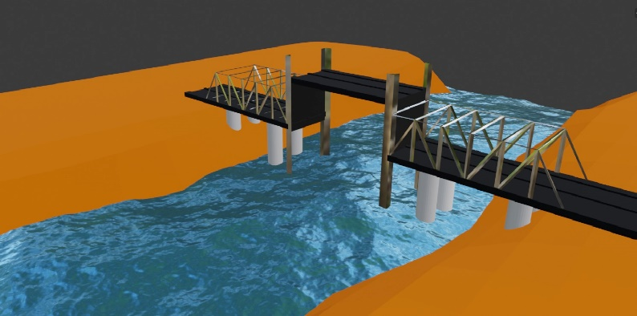

# Vertical Lift Bridge

A vertical lift bridge prototype designed to improve connectivity between Giza and Jazirat Al Qursayah while preserving boat passage on the Nile.

**STEM capstone | Team 10116 | 2024-2025 First semester**

## Egypt grand challenges

Urban congestion and population growth.

## Prototype

A Warren truss supports the bridge deck, with a motor and pulley mechanism raising the movable central span.

## Project materials

| Material | File |
| --- | --- |
| Firmware | [Arduino Nano control sketch](firmware/vertical_lift_bridge/vertical_lift_bridge.ino) |
| Portfolio | [Research portfolio](portfolio.docx) |
| Poster | [Poster availability](POSTER.md) |
| Prototype design | [Design illustrations and model availability](DESIGN.md) |

## Arduino control

The [Arduino Nano sketch](firmware/vertical_lift_bridge/vertical_lift_bridge.ino) is a reconstruction based on the team's description of the original two-button control. The original firmware was not retained. The driver and pin assignments below are assumptions for this version and should be checked against the actual circuit.

| Connection | Nano pin |
| --- | --- |
| Raise button, other terminal to GND | D2 |
| Lower button, other terminal to GND | D3 |
| L298N IN1 | D8 |
| L298N IN2 | D9 |

This version assumes one channel of an L298N H-bridge with its ENA jumper fitted. Connect the motor to that channel's outputs, power the motor from a suitable separate supply, and connect the driver ground to Nano GND. Do not power the motor from a Nano I/O pin. If a different driver was used, adapt the output logic to that driver's requirements.

Hold the raise button to wind the string and lift the midspan. Hold the lower button to reverse the motor. Releasing both buttons or pressing both sets both direction outputs LOW. The sketch includes button settling time and a short pause when changing directly between directions. If the motor runs the wrong way, swap its two output leads with power disconnected.

Open `firmware/vertical_lift_bridge/vertical_lift_bridge.ino` in the Arduino IDE and select Arduino Nano with the processor/bootloader matching the board. No extra libraries are required.

There are no automatic travel limits in this sketch; release the button before the span reaches either end. Setting the outputs LOW does not guarantee that a suspended span will hold its position; that depends on the lifting mechanism. This reconstruction has not been tested on the original hardware.

## Research context

This repository presents a student team research project. The portfolio contains the project background, design reasoning, methods, and reported findings. Prototype results are reported in their original educational context.

## Design and reported results

- Built a 1:50 prototype from palm-tree wood using a Warren truss, one 12 V DC motor, a pulley, and Arduino control.
- Carried a 5 kg load at the midpoint of the longest fixed span with 0.98 cm deflection against a 5 cm limit.
- Final grade: A+. Ranked fifth among Grade 10 capstone projects at the school.
- Second-best bridge at the Cairo University Capstone exhibition competition in 2025.

The results and distinctions above are reported in the project portfolio and the application CV.

## Attribution

This project was developed collaboratively by the team credited in the portfolio. This repository is maintained by [Yaseen301](https://github.com/Yaseen301). Team authorship and source references remain in the original documents.

